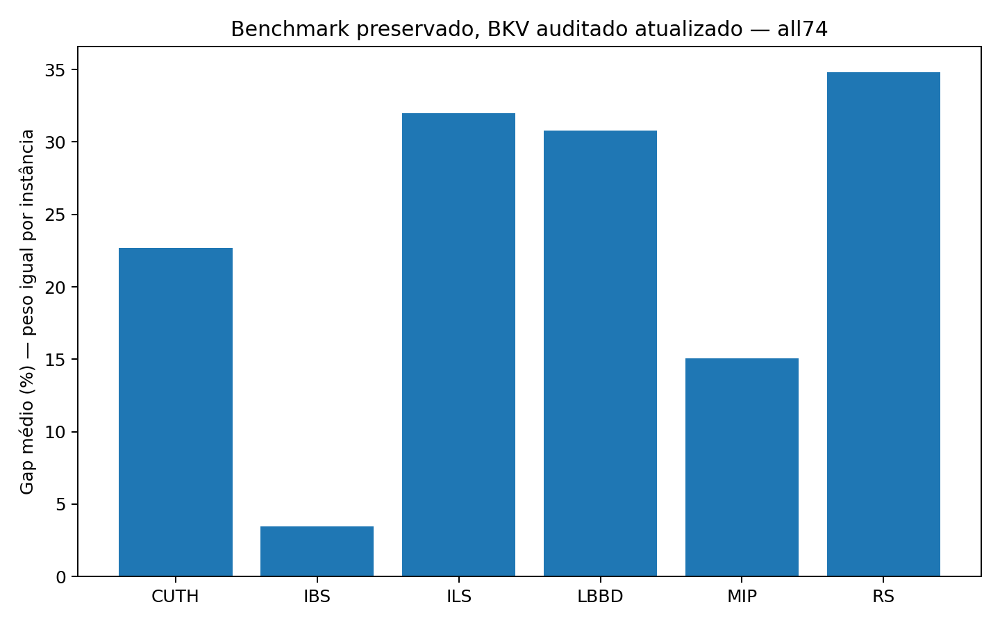

# Wildfire Instance Space

Código, instâncias e resultados do TCC **Caracterização e expansão do espaço de instâncias do Wildfire Suppression Problem**, de **Kauê de Oliveira Silva**, desenvolvido na Universidade Federal de Lavras (UFLA).

O trabalho investiga como as características de uma instância do Wildfire Suppression Problem (WSP) se relacionam ao desempenho dos algoritmos. Combina *Instance Space Analysis* (ISA), métricas de dígrafos, *Search Trajectory Networks* (STNs) do Iterated Beam Search (IBS) e geração evolutiva de instâncias para regiões pouco representadas.

## Comece aqui

- **Ler o trabalho:** [monografia em PDF](monografia/templufla_main.pdf) e [fontes LaTeX](monografia/).
- **Entender a pesquisa:** [problema e metodologia](docs/metodologia.md).
- **Consultar os resultados:** [interpretação e limites](docs/resultados.md) e [dicionário das tabelas](results/tables/README.md).
- **Executar ou verificar:** [guia de reprodução](docs/reproducao.md).
- **Localizar código e dados:** [mapa do repositório](docs/estrutura.md).

## O problema

O WSP representa a propagação do fogo em um grafo direcionado, com tempos de travessia nos arcos. Recursos de supressão ficam disponíveis em instantes específicos e podem ser alocados a vértices ainda não atingidos. O objetivo experimental é minimizar a quantidade de vértices atingidos **antes do horizonte temporal**.

A pesquisa parte de 55 instâncias existentes e produz 19 instâncias suplementares válidas e distintas. O benchmark final compara seis algoritmos nas **74 instâncias**: CUTH, IBS, ILS, LBBD, MIP e Random Search (RS).

## Conjunto experimental publicado

| Componente | Escopo |
| --- | --- |
| Instâncias | 55 originais + 19 suplementares, em formatos nativo e Harris |
| Benchmark final | 3.936 execuções, 656 por algoritmo, 444 combinações instância/algoritmo |
| Trajetórias IBS decimais | 190 execuções complementares: 19 instâncias × 10 sementes |
| STNs suplementares | 380 redes individuais + 38 agregadas, nas representações RAW e filtrada |
| ISA atual | Quatro modelos com SIFTED corrigido: controle/topologia para 55/74 instâncias |
| Geração | Três sementes, 36 alvos, 72.000 avaliações registradas nas curvas, 36 finalistas exatos |

Os resultados do benchmark e as trajetórias complementares têm finalidades diferentes. Ao agregar os seis algoritmos, use apenas `phase=benchmark` no [índice final](results/tables/analysis_index_final.csv).

## Resultados principais

O IBS apresentou o menor gap médio no conjunto de 74 instâncias. Os resultados variam entre instâncias, e CUTH e MIP também obtêm as melhores médias em parte dos casos.

| Algoritmo | Gap médio (%) | Rank médio |
| --- | ---: | ---: |
| IBS | 3,48662 | 2,06757 |
| MIP | 15,0597 | 2,16216 |
| CUTH | 22,6736 | 2,79730 |
| LBBD | 30,8110 | 4,38514 |
| ILS | 31,9818 | 5,32432 |
| RS | 34,8386 | 4,26351 |

Fonte: [resumo por algoritmo e recorte](results/tables/algorithm_summary_decimal.csv). O gap é relativo ao melhor valor observado (BKV); esse valor não é uma certificação de ótimo. As médias dão o mesmo peso a cada instância. As duas falhas ILS permanecem identificadas nos dados.



A topologia direcionada altera a representação do espaço e oferece informação estrutural adicional, com efeitos preditivos que dependem do algoritmo. A geração orientada produziu 19 instâncias aceitas nas lacunas do mapa histórico. As STNs revelam diferenças entre os percursos de busca do IBS. A [discussão dos resultados](docs/resultados.md) explica o alcance dessas observações.

## Estrutura

```text
analysis_wsp/   código Python, configurações, entradas históricas de análise e testes
data/          coleção única das 74 instâncias em dois formatos
results/       benchmark final, modelos ISA, STNs, geração, tabelas e figuras
monografia/    TCC escrito: PDF, LaTeX, referências e figuras
docs/          metodologia, resultados, reprodução e organização
scripts/       verificação e reconstrução dos resultados publicados
third_party/   implementações externas e respectivas licenças
```

Os diretórios de resultados contêm apenas os conjuntos necessários para interpretar o estudo. Novas execuções são gravadas em `experiments/`, ignorado pelo Git.

## Verificação rápida

Para conferir a integridade do material e as contagens do experimento, basta Python 3.12, sem Gurobi ou R:

```bash
git clone --recurse-submodules https://github.com/kaue-oliveira/wildfire-instance-space.git
cd wildfire-instance-space
python3 scripts/verify_repository.py
```

Para instalar o ambiente científico e executar os testes:

```bash
python3.12 -m venv .venv
source .venv/bin/activate
python -m pip install -r requirements.txt
python -m pytest -q
```

O [guia de reprodução](docs/reproducao.md) separa a conferência dos dados, a reconstrução das STNs, os ajustes ISA e a execução dos solvers. O benchmark completo demanda compilação C++ e uma instalação licenciada do Gurobi.

## Autoria e referências

Use [CITATION.cff](CITATION.cff) para citar este repositório. A monografia contém as referências completas. As origens do código externo e seus termos de uso estão em [THIRD_PARTY.md](THIRD_PARTY.md); os créditos e arquivos de licença dessas implementações foram preservados.

Para propor alterações, consulte [CONTRIBUTING.md](CONTRIBUTING.md).
